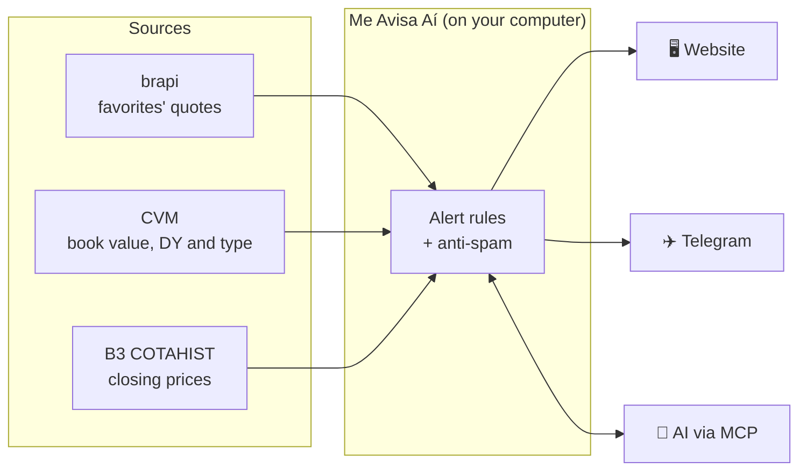
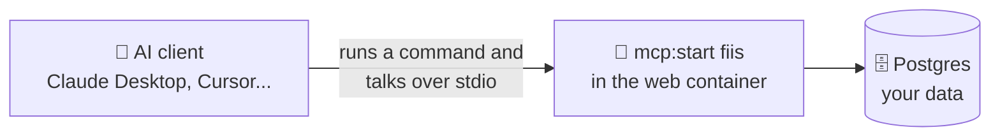
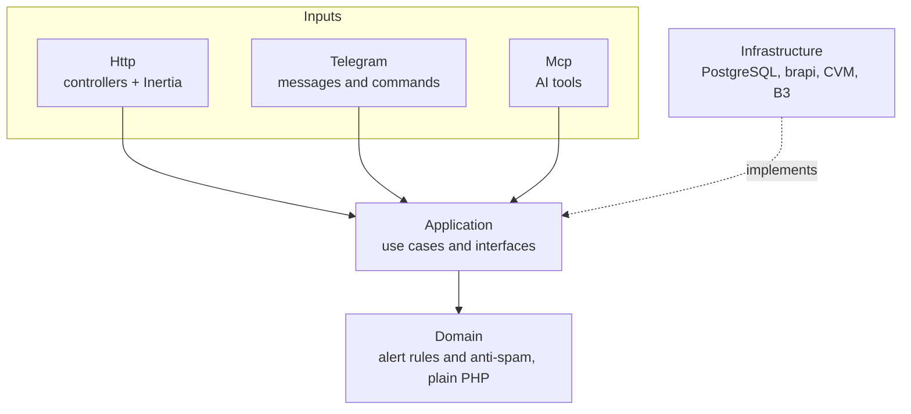

<div align="center">

# 🔔 Me Avisa Aí

**Tracks your favorite Brazilian real estate funds (FIIs) and tells you when one hits a good price.**

Instead of opening your brokerage app to check prices, you look at one screen, or get a
message, and see whether there's anything to analyze today.

[](https://github.com/Alancfops/me-avisa-AI/actions/workflows/ci.yml)
[](LICENSE)


[Português](README.md) · **English**

</div>

> [!NOTE]
> The name is Brazilian Portuguese for roughly "give me a heads-up". The "Aí" is not "AI",
> but you can talk to it through one ([see MCP](#-talk-to-an-ai-mcp)).

> [!IMPORTANT]
> **This app provides information, not investment advice.** An alert means a rule was
> met, not that an asset is cheap or should be bought.

## 📑 Contents

- [✨ What it does](#-what-it-does)
- [🧭 How it works](#-how-it-works)
- [🚀 Installation](#-installation)
- [📲 Telegram bot](#-telegram-bot)
- [🤖 Talk to an AI (MCP)](#-talk-to-an-ai-mcp)
- [🔌 Start with the computer](#-start-with-the-computer)
- [⌨️ Commands](#️-commands)
- [🏗️ Architecture](#️-architecture)
- [🧩 Modules](#-modules)
- [📚 Documentation](#-documentation)

## ✨ What it does

### 🔔 Alerts

Each favorite has one main alert, besides the sharp drop alert.

| Alert | Fires when |
|---|---|
| 🎯 **Target price** | the price reaches or falls below your value |
| 📏 **Buy range** | the price enters a range |
| 🤖 **Automatic rule** | the price is 5% below its 30-session average **and** the P/B ratio is below the fund's own 12-month median |
| 📉 **Sharp drop** | the share price falls more than 3% in a day |

**Anti-spam** avoids repeating the same alert without hiding a different one. The full
rules, in Portuguese, are in [`docs/fiis/alert.md`](docs/fiis/alert.md).

### 📊 Analysis

- **Fund page:** P/B compared with the 12-month median, price compared with the 6- and
  12-month averages, price and P/B charts, and the latest estimated distribution.
- **All FIIs:** the funds traded on B3, with type (brick, paper etc.), segment, price, P/B
  and 12-month DY, filters and a favorite button.
- **Ceiling price:** the highest price at which the fund yields the annual rate you pick,
  with a button to use it as the target price.

### 💼 Portfolio

How many shares you hold of each fund, the position value and the estimated income.

### 📲 Where alerts arrive

| Channel | How |
|---|---|
| 🖥️ **Website** | the alerts page and the dashboard, at <http://127.0.0.1:8000> |
| ✈️ **Telegram** | every alert becomes a message, and commands such as `/alertas` and `/ver CÓDIGO` answer right away ([setup](#-telegram-bot)) |
| 💬 **AI** | Claude Desktop, Claude Code or Cursor read and change favorites, alerts and portfolio in a conversation ([setup](#-talk-to-an-ai-mcp)) |

Quotes update every 30 minutes, from 10:00 to 18:00 Brasília time, on weekdays. The
**Health** page shows when each source was last read.

> [!WARNING]
> **Under construction.** The interface is still minimal, without the visual polish, and
> the demo mode does not exist yet. Funds whose ISIN is declared by more than one CVM
> record have no book value, so the automatic rule does not fire for them.

## 🧭 How it works



| Source | Provides | How often |
|---|---|---|
| [brapi](https://brapi.dev) | favorites' quotes | every 30 min during trading |
| [CVM FII Monthly Report](https://dados.cvm.gov.br/dataset/fii-doc-inf_mensal) | book value, dividend yield and fund type | once a day |
| [B3 (COTAHIST)](https://www.b3.com.br/pt_br/market-data-e-indices/servicos-de-dados/market-data/historico/mercado-a-vista/cotacoes-historicas/) | daily and historical closing prices | once a day |

Everything runs on your computer. There is no login, cloud server or port open to the
internet: one installation, one person.

## 🚀 Installation

The recommended path uses containers: you don't install PHP, Node or a database, only the
container program.

| Your computer | Use | Status |
|---|---|---|
| 🐧 Linux | [Docker Engine](https://docs.docker.com/engine/install/) | ✅ Tested |
| 🍎 Mac (Intel or Apple Silicon) | [OrbStack](https://orbstack.dev) (lighter) or [Docker Desktop](https://docs.docker.com/desktop/setup/install/mac-install/) | ⚠️ Not tested yet: tell us if something breaks |
| 🪟 Windows | [Docker Desktop](https://docs.docker.com/desktop/setup/install/windows-install/) with WSL 2 | ⚠️ Not tested yet |
| Any, without Docker | [Podman](#podman) | ⚠️ Not tested yet |
| Without containers | [PHP, Node and Postgres directly](#without-containers) | 🚧 Not available yet |

> [!CAUTION]
> There is no login. Don't expose the app to the internet.

### 1. Install what's missing

<details>
<summary><b>🍎 Mac</b></summary>

1. Open **Terminal** (Applications → Utilities).
2. Install Apple's command line tools, which include `git` and `make`:

   ```bash
   xcode-select --install
   ```

   If it says "already installed", you're set.
3. Install a container program. With [Homebrew](https://brew.sh):

   ```bash
   brew install orbstack     # or: brew install --cask docker
   open -a OrbStack          # or: open -a Docker
   ```

   Without Homebrew, download the installer from [OrbStack](https://orbstack.dev) or
   [Docker Desktop](https://docs.docker.com/desktop/setup/install/mac-install/). Open the
   program once and wait for it to finish starting. OrbStack is free for personal use;
   check the license if you use it at work.

</details>

<details>
<summary><b>🐧 Linux</b></summary>

Install [Docker Engine](https://docs.docker.com/engine/install/) with the Compose plugin,
plus `git` and `make` (on Ubuntu: `sudo apt install git make`). To run Docker without
`sudo`, follow the [post-installation steps](https://docs.docker.com/engine/install/linux-postinstall/).

</details>

<details>
<summary><b>🪟 Windows</b></summary>

Install [Docker Desktop](https://docs.docker.com/desktop/setup/install/windows-install/)
with WSL 2. Open the Ubuntu (WSL) terminal, install `git` and `make`
(`sudo apt install git make`) and follow the next steps inside it.

</details>

To check, run `docker compose version`. It should print a version.

### 2. Download and install the app

```bash
git clone https://github.com/Alancfops/me-avisa-AI.git
cd me-avisa-AI
make install
```

`make install` creates the `.env` configuration file, builds the images and prepares the
database. The first time takes a few minutes.

### 3. Start the app

```bash
make start
```

Open <http://127.0.0.1:8000> in your browser.

### 4. Paste the brapi key

brapi provides the quotes. Create a free account at <https://brapi.dev/dashboard> and copy
the token from the dashboard. The free plan gives 15,000 requests a month, and each
favorite uses about 350.

In the app, open **Configurações** (Settings), paste the token into **Chave da brapi**
and click **Salvar chave**. The app checks the key with brapi and stores it encrypted; you
don't need to open any file. While the key is missing, a notice at the top of the site
leads to that field.

> [!TIP]
> Prefer a file? Put `BRAPI_TOKEN=your_token` in `.env` and run `make start`. The key in
> `.env` takes priority over the one saved on the site.

### 5. Run the first load

Loads the fund list, the CVM reports and B3 closing prices. The yearly B3 history
downloads files of about 90 MB, so it can take a few minutes:

```bash
make load
```

After that, everything updates on its own: quotes every 30 minutes during trading and the
rest once a day.

### 6. Check

- [ ] The **Saúde** (Health) tab shows the last read time of each source.
- [ ] Favorite a FII in **Todos os FIIs** (All FIIs) and set when you want to be alerted.
- [ ] To get alerts on your phone, set up the [Telegram bot](#-telegram-bot).

### Update, stop and uninstall

| I want to | Command |
|---|---|
| ⬆️ Update to the latest version | `git pull` then `make start` (the database updates itself) |
| ⏹️ Stop the app | `make stop` |
| 📜 See what's going on | `make logs` (exit with Ctrl+C) |
| 💾 Keep a copy of the data | `make backup` (see [Backup](#backup)) |
| 🗑️ Uninstall and **delete all data** | Run `make backup` and keep the `backups/` folder and the `.env` file somewhere else. Then `docker compose down -v` (on Podman, `podman compose down -v`) and delete the `me-avisa-AI` folder |

### Backup

Your favorites, rules, alerts, portfolio and keys live in the app's database. To save a
copy, with the app running:

```bash
make backup
```

The copy goes to the `backups/` folder, with the date and time in the name
(`backups/me-avisa-ai-2026-11-06-153000.sql.gz`). It's worth making one before updating
or uninstalling. The folder is ignored by git and holds your data, so don't share the
files.

To bring the app back to a copy:

```bash
make restore FILE=backups/me-avisa-ai-2026-11-06-153000.sql.gz
```

`make restore` asks before replacing the data and, before replacing, saves the current
data in `backups/`.

> [!IMPORTANT]
> The brapi and bot keys come along in the copy, encrypted. To read them, `.env` must
> have the same `APP_KEY` as when the copy was made. When moving a copy to another
> installation, take the `.env` too.

### Troubleshooting

| Problem | What to do |
|---|---|
| `make: command not found` | Mac: `xcode-select --install`. Linux/WSL: `sudo apt install make` |
| `Cannot connect to the Docker daemon` | Open OrbStack or Docker Desktop and wait for it to start |
| Port 8000 is already in use | Close the other program using port 8000 |
| On Linux, permission error on `.env` | Run `make install` again: it uses your user (`APP_UID`) |
| A source with an error on the Health page | Normal right after booting or without internet; the app retries on its own |

Without `make`, use Compose directly: `cp .env.example .env`, `docker compose up -d --build`
and, for the first load, the commands in the `Makefile`'s `load` rule, each prefixed with
`docker compose exec web`.

### Podman

<details>
<summary>Install and run with Podman</summary>

Requires [Podman](https://podman.io/docs/installation) with Compose support. On a Mac:

```bash
brew install podman podman-compose
podman machine init
podman machine start
```

On Linux (Ubuntu or Debian), besides `git` and `make`:

```bash
sudo apt install podman podman-compose
```

Follow steps 2 to 6 above, adding `COMPOSE="podman compose"` to every `make`:

```bash
make install COMPOSE="podman compose"
make start COMPOSE="podman compose"
make load COMPOSE="podman compose"
```

On Podman, the app doesn't come back on its own when the computer boots (see
[Start with the computer](#-start-with-the-computer)).

</details>

### Without containers

<details>
<summary>🚧 Not available yet: how this option will work</summary>

The `make native-*` commands don't exist yet.

Requires PHP 8.4 (with `pdo_pgsql`, `bcmath` and `zip`), Composer, Node 22, PostgreSQL 17
and `make`. On a Mac, with [Homebrew](https://brew.sh):

```bash
brew install php composer node@22 postgresql@17
brew services start postgresql@17
createdb me_avisa_ai
```

Install and start the app:

```bash
git clone https://github.com/Alancfops/me-avisa-AI.git
cd me-avisa-AI
make native-install   # creates .env, installs dependencies and prepares the database
make native-start     # starts the site, the scheduler and the queue together
```

Set `BRAPI_TOKEN` and the database credentials in `.env`. In this mode, the app doesn't
start with the computer by default.

</details>

## 📲 Telegram bot

With the bot, every alert on the website also reaches your Telegram, and you can check
favorites, portfolio and funds with commands, without opening the app.

> [!NOTE]
> **Why does each person create their own bot?** The app installed on your computer is
> what reads and answers the messages. One bot for everyone would need a server on the
> internet holding everyone's data, and Me Avisa Aí runs only on your machine. Creating a
> bot is free and takes about 2 minutes.

### 1. Create the bot

Do it in Telegram **on your computer** (the app or <https://web.telegram.org>), so the
token is already on the computer, ready to paste into the app.

| Step | You do | @BotFather answers |
|---|---|---|
| 1 | Open [@BotFather](https://t.me/BotFather) (the official one, with the blue check), click **Start** and send `/newbot` | *Alright, a new bot. How are we going to call it?* |
| 2 | Send the name: `Me Avisa Aí` | *Now let's choose a username for your bot. It must end in `bot`.* |
| 3 | Send a username ending in `bot`, with something of yours in the middle, such as `meavisaai_maria_bot` | If taken: *Sorry, this username is already taken.* Try another |
| 4 | — | *Done! Congratulations on your new bot.* and, below *Use this token to access the HTTP API:*, the **token**, a line like `123456789:AAH...` |

Click the token to copy it.

### 2. Put the token in the app

Open the app's **Telegram** tab (<http://127.0.0.1:8000/telegram>), paste the token and
click **Salvar token**. No file or terminal needed: the app checks the token with Telegram
and stores it encrypted in the database. Within seconds the bot starts working, without
restarting anything.

The app also gives the bot the default name, description and command menu (what shows up
when you type `/` in the chat).

> [!TIP]
> Prefer a file? Put `TELEGRAM_BOT_TOKEN=your_token` in `.env` and run `make start`. The
> token in `.env` takes priority over the one in the tab.

### 3. Connect your chat

The same tab shows a **QR code** and an **Abrir no Telegram** (Open in Telegram) button:

- 📱 **on your phone:** point the camera at the QR code and tap **Start** in Telegram;
- 💻 **on your computer:** click **Abrir no Telegram** and then **Start**.

The bot replies "✅ Conectado" and the tab switches to **Conectado** (Connected) on its
own. Use **Enviar mensagem de teste** (Send test message) to check.

The code inside the link proves that whoever sent `/start` is the person with the app
open. It's valid for 15 minutes and works only once. Once connected, the bot ignores any
other chat.

### Bot commands

| Command | Answer |
|---|---|
| `/alertas` | Favorites that met a rule today |
| `/ver CÓDIGO` | Price, P/B, DY and distribution of a fund (the B3 ticker, ending in 11) |
| `/favoritos` | Your favorites with their price |
| `/carteira` | Portfolio value and estimated income |
| `/ajuda` | The command list |

The "Ver no app" links in the messages open only on the computer running the app. On the
phone, use the commands.

### Disconnect, switch bots and security

- **Disconnect:** the **Desconectar** button in the tab. Alerts keep showing on the
  website. To come back, connect again with the QR code.
- **Switch bots:** **Usar outro bot** in the tab, then paste the new token. If the token
  is in `.env`, this button doesn't show: change the `TELEGRAM_BOT_TOKEN` line and run
  `make start`.
- **Token leaked:** send `/revoke` to @BotFather, pick the bot and paste the new token in
  the tab (or in `.env`). Whoever has the token controls the bot, so don't share it.
- The app fetches messages from Telegram; nothing on your computer is exposed to the
  internet.

### If the bot doesn't answer

| What you see | What to do |
|---|---|
| No answer | Check that the app is running (`make start`). Without the app, the bot stays silent. |
| "O Telegram recusou o token" | The token was revoked or mistyped. Copy it again from @BotFather. |
| "O Telegram não respondeu agora" | No internet or Telegram is down. The bot recovers on its own. |
| "Este bot ainda não está conectado" | Generate the code in the tab and connect with the QR code. |

The **Saúde** (Health) tab shows the bot's last successful send or read and its last
error.

## 🤖 Talk to an AI (MCP)

Me Avisa Aí has an [MCP](https://modelcontextprotocol.io) server: a way for an AI client
running on your computer (Claude Desktop, Claude Code, Cursor) to read and change your
favorites, alerts and portfolio. You talk, the AI uses the app. The tools return
Portuguese, but you can ask, and get answers, in any language.

```text
You:    Give me a summary of my FIIs and my portfolio.
Claude: (reads favorites, portfolio and recent alerts)
        Your 6 favorites are up 0.4% on average today. MXRF11 has a P/B of 0.95,
        below its 12-month median (1.02)...
```

Other requests that work:

- 📈 "How are my FIIs doing today?" · "Which alerts fired this week?"
- ⭐ "Favorite MXRF11 and set the target to R$ 9.50." · "Remove XPML11 from my favorites."
- 💼 "I bought 10 more shares of KNRI11." · "How much does my portfolio yield per month?"

> [!IMPORTANT]
> **The app must be running.** The server runs inside the `web` container. Without
> `make start`, the AI can't answer. And, like the rest of the app, the AI informs and
> doesn't advise.

### How it works



The AI client doesn't reach the app through an address or a port. It **runs a command** on
your computer:

```bash
docker compose --project-directory /path/to/the/app exec -T web php artisan mcp:start fiis
```

and talks to that command through the terminal's input and output (`stdio`). The client
starts the command when it opens and stops it when you quit. That command is what
`make connect` writes into the client's config.

That's why MCP works **only on the computer where the app is installed**:

| | Client |
|---|---|
| ✅ Works | Claude Desktop, Claude Code, Cursor or Antigravity installed on **this** machine |
| ❌ Doesn't work | claude.ai in the browser, the Claude phone app, a client on another computer (even on the same Wi-Fi) |

The ones that don't work have no way to run a command on your computer. Reaching the app
from outside would mean opening a port, with a tunnel and a login, and the project doesn't
do that on purpose.

> [!NOTE]
> "Only on this machine" is about the link to the app, not the conversation. The AI model
> runs on the client provider's servers (Anthropic, Cursor, Google). What the tools return,
> like favorites, prices and portfolio, goes there as part of the conversation, like any
> message you type. The app itself opens no port and receives nothing from outside.

### Tools

| To read | To change |
|---|---|
| `list_favorites`: favorites with price, changes, P/B, DY, alert and today's alerts | `add_favorite` / `remove_favorite`: add or remove a favorite |
| `show_favorite`: one fund in detail, with averages, rules and distributions | `change_alert`: target price, range or automatic rule |
| `recent_alerts`: recent alerts | `change_holding`: add, remove or set shares |
| `show_portfolio`: portfolio, value and estimated income | `remove_holding`: remove a fund from the portfolio |
| `search_funds`: search the FII catalog | |

The AI only reads your **favorites** in detail; other funds show up through search.
Distributions are **estimated** from the CVM report, and the fund may have paid a
different amount.

### 🛡️ Far-price lock

If the AI tries to save a target price (or range limits) more than **30%** away from the
current price, up or down, the app doesn't save it. It shows the requested value, the
current price and the distance, and saves only after you confirm. This catches decimal
mistakes, like R$ 95 instead of R$ 9.50.

### Connect with `make connect`

```bash
make connect
```

It asks which AI you use (Claude Desktop, Claude Code, Cursor or Antigravity) and:

- writes the server into that client's config file, keeping what is already there and
  making a backup first (the message shows the command to go back to it);
- shows which installation (folder) the AI will use;
- tests the connection and tells you the next step, like quitting and reopening the client.

To skip the question: `make connect CLIENT=cursor` (the names are `claude-desktop`,
`claude-code`, `cursor`, `antigravity` and `json`, which only prints the JSON). With
Podman: `make connect COMPOSE="podman compose"`. For Claude Code, the command writes
nothing: it shows what to run. It works on Linux and Mac; on Windows, set it up by hand.

#### Examples

From the menu, connecting Claude Desktop (the app's messages are in Portuguese):

```text
$ make connect
Qual IA você quer ligar ao app?
  1) Claude Desktop
  2) Claude Code
  3) Cursor
  4) Antigravity
  5) Só mostrar o JSON
Número: 1

A IA vai usar a instalação em /home/you/me-avisa-AI.

✅ Gravado em /home/you/.config/Claude/claude_desktop_config.json.
Backup do arquivo anterior: /home/you/.config/Claude/claude_desktop_config.json.bak-2026-11-10-153318
Para voltar a ele: cp '/home/you/.config/Claude/claude_desktop_config.json.bak-2026-11-10-153318' '/home/you/.config/Claude/claude_desktop_config.json'

Testando a conexão...
✅ Conexão testada: a IA enxerga as ferramentas do app.

Próximo passo: feche e abra o Claude Desktop para ele carregar o app.
```

It says which installation the AI will use, where it wrote (and the backup), that the
connection test passed, and to quit and reopen the client.

Other cases:

| Command or situation | What happens |
|---|---|
| `make connect CLIENT=cursor` | Writes `~/.cursor/mcp.json` without asking which AI. |
| `make connect CLIENT=json` | Only prints the JSON, to paste by hand. Writes nothing. |
| `make connect COMPOSE="podman compose"` | Same, using Podman. |
| Running it again | `✅ Já estava configurado ...` (already configured): nothing changes. |
| The client already points to another folder (another install) | Shows the current and the new one and asks `Trocar pelo novo?` (replace?). If you say no, nothing changes. |
| App stopped | Writes anyway and warns: `Configurado, mas o app está parado: rode make start.` (run `make start`). |
| Client file with broken JSON | Leaves the file alone and says what to fix. |

### Manual setup

#### Claude Desktop

1. Run `make mcp-config`. It prints a JSON snippet with this folder's path and the
   `COMPOSE` in use (with Podman: `make mcp-config COMPOSE="podman compose"`).
2. Paste the snippet into `claude_desktop_config.json`. If the file already has
   `mcpServers`, add only the `me-avisa-ai` block.

   | System | File |
   |---|---|
   | 🍎 Mac | `~/Library/Application Support/Claude/claude_desktop_config.json` |
   | 🪟 Windows | `%APPDATA%\Claude\claude_desktop_config.json` |
   | 🐧 Linux | `~/.config/Claude/claude_desktop_config.json` |

3. Quit and reopen Claude Desktop.

If the server doesn't show up, the error is in Claude Desktop's log
(`mcp-server-me-avisa-ai.log`, in the `logs/` folder next to the config file).

#### Claude Code

Set `ME_AVISA_AI_DIR` to the folder where the app lives, in your shell
(`export ME_AVISA_AI_DIR=~/me-avisa-AI`) or in Claude Code's `settings.json`:

```json
{ "env": { "ME_AVISA_AI_DIR": "/path/to/me-avisa-AI" } }
```

Then, inside Claude Code:

```text
/plugin marketplace add Alancfops/me-avisa-AI
/plugin install me-avisa-ai@me-avisa-ai
```

#### Other clients

Cursor and Antigravity use the same JSON from `make mcp-config`. Paste the JSON into the
client's file and save:

| Client | File |
|---|---|
| Cursor | `~/.cursor/mcp.json` |
| Antigravity | `~/.gemini/config/mcp_config.json` |

Other local MCP clients follow the same idea: a command that opens the server over `stdio`.

> [!TIP]
> Run `make connect` or `make mcp-config` in the folder of the installation the AI should
> use: the path that goes to the client is that folder's. `make mcp-config` only prints the
> JSON and writes nothing.

## 🔌 Start with the computer

With Docker (Linux), Docker Desktop or OrbStack, the app comes back on its own when the
computer boots: Docker starts with the system and brings the app's services back, unless
you stopped them with `make stop`. Podman is different (see below).

While the app is stopped, no alerts go out, on the website or on Telegram. When it comes
back, it catches up on the closing prices and reports it missed.

### Stop and start just the app

| I want to | Command |
|---|---|
| Stop the app now and keep it from coming back on boot | `make stop` |
| Start it again (and have it start on boot again) | `make start` |

This is the simplest way: Docker still starts with the system, but the app stays stopped
until you run `make start`.

### Don't start Docker with the computer

| Where | Turn off | Turn back on |
|---|---|---|
| 🐧 Linux (Docker Engine) | `sudo systemctl disable docker.service docker.socket` | `sudo systemctl enable --now docker.service docker.socket` |
| Docker Desktop (Windows, Mac, Linux) | **Settings → General**, uncheck **Start Docker Desktop when you sign in** | Check the same option |
| 🍎 OrbStack (Mac) | **Settings → General**, uncheck **Start at login** | Check the same option |

With Docker off at boot, open Docker (or run `sudo systemctl start docker`) and then
`make start` when you want to use the app.

### With Podman

Podman has no service that brings containers back on its own, so the app does **not**
start with the computer. After booting:

```bash
podman machine start              # Mac only
make start COMPOSE="podman compose"
```

To stop: `make stop COMPOSE="podman compose"`.

## ⌨️ Commands

To see the full list, run `make` with nothing after it.

**Day to day**

| Command | What it does |
|---|---|
| `make start` / `make stop` | Starts or stops the app |
| `make restart` / `make logs` | Restarts or follows the logs |
| `make backup` / `make restore FILE=...` | Saves a database copy to `backups/` or restores one |

**Installation and data**

| Command | What it does |
|---|---|
| `make install` | Creates `.env` without overwriting an existing one, builds the images and prepares the database |
| `make load` | First load: funds, CVM reports and B3 closing prices |
| `make migrate` | Updates the database |
| `make connect` | Connects an AI (Claude, Cursor, Antigravity) to the app |
| `make mcp-config` | Prints the MCP server JSON to paste by hand |

**Development**

| Command | What it does |
|---|---|
| `make test` | Runs the tests on a separate database, without touching your data |
| `make check` | Runs the CI backend checks |
| `make lint` / `make format` | Checks or fixes formatting |
| `make shell` | Opens a terminal in a tools container |
| `make backtest TICKER=KNRI11` | Counts the alerts that would have fired on past prices, without saving anything; it doesn't say whether buying would have paid off |

## 🏗️ Architecture

A modular Laravel monolith with pragmatic Clean Architecture. The alert rules don't depend
on the framework, the database or the APIs, so they can be tested on their own.



```text
app/Modules/Fiis/
├── Domain/          alert rules and anti-spam, plain PHP
├── Application/     use cases and interfaces
├── Infrastructure/  PostgreSQL, brapi, CVM, B3
└── Http/            controllers and Inertia responses

app/Modules/Telegram/  bot: messages, commands and alert delivery
app/Modules/Mcp/       MCP server: tools for favorites, alerts and portfolio
```

Architecture tests keep these layers from mixing. The website, the bot and the AI share
the same use cases, so a rule works the same way in all three.

| Layer | Technology |
|---|---|
| Backend | Laravel 13, PHP 8.4, `laravel/mcp` |
| Front end | React 19 with Inertia, TypeScript, Tailwind v4, shadcn/ui |
| Data | PostgreSQL 17 |
| Runtime | Docker Compose (web, scheduler, queue and bot) |
| Quality | Pest, architecture tests, Pint, Larastan, `vp check` (Vite+) and CI on GitHub Actions |

## 🧩 Modules

| Module | Status |
|---|---|
| 🏢 **FIIs:** favorites, market data, rules, website alerts, fund page and portfolio | ✅ Done |
| ✈️ **Telegram bot:** alerts and commands | ✅ Done |
| 🤖 **MCP server:** read and manage favorites, alerts and portfolio by talking to an AI | ✅ Done |
| 🌐 AI on the web and on the phone (tunnel and login) | 🔜 Later |
| 📈 Stocks and ETFs | 🔜 Later |

## 📚 Documentation

Most documents are in Portuguese.

| Topic | Where |
|---|---|
| FII module design | [`docs/superpowers/specs/2026-10-29-modulo-fiis-design.md`](docs/superpowers/specs/2026-10-29-modulo-fiis-design.md) |
| Telegram bot design | [`docs/superpowers/specs/2026-11-04-bot-telegram-design.md`](docs/superpowers/specs/2026-11-04-bot-telegram-design.md) |
| MCP server design | [`docs/superpowers/specs/2026-11-09-servidor-mcp-design.md`](docs/superpowers/specs/2026-11-09-servidor-mcp-design.md) |
| Product rules | [FIIs](docs/fiis/), [stocks](docs/acoes/), [ETFs](docs/etfs/) and [bot](docs/bot/) |
| Visual prototype | [`docs/prototipo-lovable/`](docs/prototipo-lovable/) |
| What came from the previous version | [`docs/legado.md`](docs/legado.md) |

## 📄 License

[MIT](LICENSE). Use, study and adapt freely.
