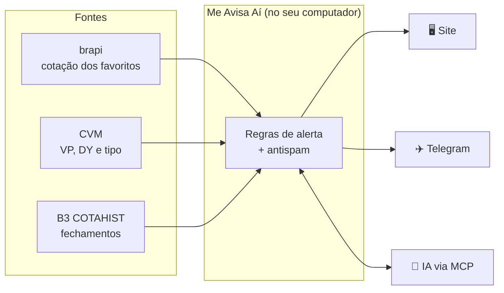
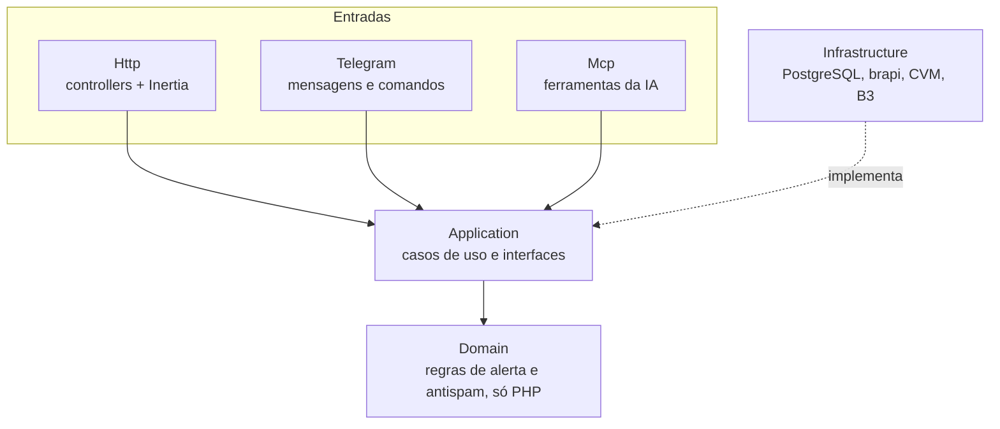

<div align="center">

# 🔔 Me Avisa Aí

**Acompanha seus FIIs favoritos e avisa quando algum chega a um preço bom.**

Em vez de abrir o home broker para conferir preço, você olha uma tela, ou recebe uma
mensagem, e sabe se tem algo para analisar hoje.

[](https://github.com/Alancfops/me-avisa-AI/actions/workflows/ci.yml)
[](LICENSE)


**Português** · [English](README.en.md)

</div>

> [!NOTE]
> O "Aí" vem de "me avisa aí". Não é IA, mas dá para conversar com ele usando uma
> ([veja o MCP](#-conversar-com-uma-ia-mcp)).

> [!IMPORTANT]
> **Este app informa e não recomenda investimentos.** Um aviso diz que uma regra foi
> atendida, não que o ativo está barato ou deve ser comprado.

## 📑 Sumário

- [✨ O que ele faz](#-o-que-ele-faz)
- [🧭 Como funciona](#-como-funciona)
- [🚀 Instalação](#-instalação)
- [📲 Bot do Telegram](#-bot-do-telegram)
- [🤖 Conversar com uma IA (MCP)](#-conversar-com-uma-ia-mcp)
- [🔌 Iniciar com o computador](#-iniciar-com-o-computador)
- [⌨️ Comandos](#️-comandos)
- [🏗️ Arquitetura](#️-arquitetura)
- [🧩 Módulos](#-módulos)
- [📚 Documentação](#-documentação)

## ✨ O que ele faz

### 🔔 Alertas

Cada favorito tem um alerta principal, além do aviso de queda forte.

| Alerta | Avisa quando |
|---|---|
| 🎯 **Preço alvo** | o preço chega ao valor definido ou fica abaixo dele |
| 📏 **Faixa de compra** | o preço entra em um intervalo |
| 🤖 **Regra automática** | o preço está 5% abaixo da média de 30 pregões **e** o P/VP está abaixo da mediana de 12 meses do próprio fundo |
| 📉 **Queda forte** | a cota cai mais de 3% no dia |

O **antispam** evita repetir o mesmo aviso, sem esconder um aviso diferente. As regras
completas estão em [`docs/fiis/alert.md`](docs/fiis/alert.md).

### 📊 Análise

- **Página do fundo:** P/VP comparado com a mediana de 12 meses, preço comparado com as
  médias de 6 e 12 meses, gráficos de preço e P/VP e o último rendimento estimado.
- **Todos os FIIs:** os fundos negociados na B3, com tipo (tijolo, papel etc.), segmento,
  preço, P/VP e DY 12m, filtros e botão de favoritar.
- **Preço teto:** o preço máximo para o fundo render a taxa anual que você escolher, com um
  botão para usá-lo como preço alvo.

### 💼 Carteira

Quantas cotas você tem de cada fundo, o valor da posição e o rendimento estimado.

### 📲 Onde os avisos chegam

| Canal | Como |
|---|---|
| 🖥️ **Site** | a tela de avisos e o painel, em <http://127.0.0.1:8000> |
| ✈️ **Telegram** | todo aviso vira mensagem, e comandos como `/alertas` e `/ver CÓDIGO` respondem na hora ([como ligar](#-bot-do-telegram)) |
| 💬 **IA** | Claude Desktop, Claude Code ou Cursor consultam e mudam favoritos, alertas e carteira conversando ([como ligar](#-conversar-com-uma-ia-mcp)) |

As cotações são atualizadas a cada 30 minutos, das 10h às 18h, em dias úteis. A tela de
**Saúde** mostra quando cada fonte foi lida pela última vez.

> [!WARNING]
> **Em construção.** A interface ainda é mínima, sem o acabamento visual, e o modo de
> demonstração não existe ainda. Fundos em que mais de um registro da CVM declara o mesmo
> ISIN ficam sem VP, e a regra automática não dispara para eles.

## 🧭 Como funciona



| Fonte | O que fornece | Frequência |
|---|---|---|
| [brapi](https://brapi.dev) | cotação dos favoritos | a cada 30 min no pregão |
| [Informe Mensal de FII da CVM](https://dados.cvm.gov.br/dataset/fii-doc-inf_mensal) | valor patrimonial, dividend yield e tipo do fundo | uma vez por dia |
| [B3 (COTAHIST)](https://www.b3.com.br/pt_br/market-data-e-indices/servicos-de-dados/market-data/historico/mercado-a-vista/cotacoes-historicas/) | fechamentos diários e históricos | uma vez por dia |

Tudo roda no seu computador. Não há login, servidor na nuvem nem porta aberta na
internet: uma instalação, uma pessoa.

## 🚀 Instalação

O caminho recomendado usa contêineres: você não instala PHP, Node nem banco de dados, só
o programa de contêineres.

| Seu computador | Use | Situação |
|---|---|---|
| 🐧 Linux | [Docker Engine](https://docs.docker.com/engine/install/) | ✅ Testado |
| 🍎 Mac (Intel ou Apple Silicon) | [OrbStack](https://orbstack.dev) (mais leve) ou [Docker Desktop](https://docs.docker.com/desktop/setup/install/mac-install/) | ⚠️ Ainda não testado: conte se der problema |
| 🪟 Windows | [Docker Desktop](https://docs.docker.com/desktop/setup/install/windows-install/) com WSL 2 | ⚠️ Ainda não testado |
| Qualquer um, sem Docker | [Podman](#podman) | ⚠️ Ainda não testado |
| Sem contêineres | [PHP, Node e Postgres direto](#sem-contêineres) | 🚧 Ainda não disponível |

> [!CAUTION]
> Não há login. Não exponha o app na internet.

### 1. Instale o que falta

<details>
<summary><b>🍎 Mac</b></summary>

1. Abra o **Terminal** (Aplicativos → Utilitários).
2. Instale as ferramentas da Apple, que trazem o `git` e o `make`:

   ```bash
   xcode-select --install
   ```

   Se aparecer "already installed", já está pronto.
3. Instale um programa de contêineres. Com o [Homebrew](https://brew.sh):

   ```bash
   brew install orbstack     # ou: brew install --cask docker
   open -a OrbStack          # ou: open -a Docker
   ```

   Sem Homebrew, baixe o instalador no site do [OrbStack](https://orbstack.dev) ou do
   [Docker Desktop](https://docs.docker.com/desktop/setup/install/mac-install/). Abra o
   programa uma vez e espere ele terminar de iniciar. O OrbStack é gratuito para uso
   pessoal; confira a licença se for usar no trabalho.

</details>

<details>
<summary><b>🐧 Linux</b></summary>

Instale o [Docker Engine](https://docs.docker.com/engine/install/) com o plugin Compose,
além de `git` e `make` (no Ubuntu: `sudo apt install git make`). Para rodar o Docker sem
`sudo`, siga o [pós-instalação](https://docs.docker.com/engine/install/linux-postinstall/).

</details>

<details>
<summary><b>🪟 Windows</b></summary>

Instale o [Docker Desktop](https://docs.docker.com/desktop/setup/install/windows-install/)
com o WSL 2. Abra o terminal do Ubuntu (WSL), instale `git` e `make`
(`sudo apt install git make`) e siga os próximos passos dentro dele.

</details>

Para conferir, rode `docker compose version`. Deve aparecer uma versão.

### 2. Baixe e instale o app

```bash
git clone https://github.com/Alancfops/me-avisa-AI.git
cd me-avisa-AI
make install
```

O `make install` cria o arquivo de configuração `.env`, monta as imagens e prepara o
banco. Na primeira vez, leva alguns minutos.

### 3. Suba o app

```bash
make start
```

Abra <http://127.0.0.1:8000> no navegador.

### 4. Cole a chave da brapi

A brapi fornece as cotações. Crie uma conta gratuita em <https://brapi.dev/dashboard> e
copie o token do painel. O plano gratuito dá 15 mil requisições por mês, e cada favorito
consome cerca de 350.

No app, abra **Configurações**, cole o token em **Chave da brapi** e clique em **Salvar
chave**. O app confere a chave com a brapi e guarda criptografada; não precisa abrir
nenhum arquivo. Enquanto faltar a chave, um aviso no topo do site leva até esse campo.

> [!TIP]
> Prefere arquivo? Ponha `BRAPI_TOKEN=seu_token` no `.env` e rode `make start`. A chave
> do `.env` tem prioridade sobre a do site.

### 5. Faça a primeira carga

Carrega a lista de fundos, os informes da CVM e os fechamentos da B3. O histórico anual
da B3 baixa arquivos de cerca de 90 MB, então pode demorar alguns minutos:

```bash
make load
```

Depois disso, tudo se atualiza sozinho: cotações a cada 30 minutos no pregão e o resto
uma vez por dia.

### 6. Confira

- [ ] A aba **Saúde** mostra o horário da última leitura de cada fonte.
- [ ] Favorite um FII em **Todos os FIIs** e configure quando quer ser avisado.
- [ ] Para receber os avisos no celular, ligue o [bot do Telegram](#-bot-do-telegram).

### Atualizar, parar e desinstalar

| Quero | Comando |
|---|---|
| ⬆️ Atualizar para a versão mais nova | `git pull` e depois `make start` (o banco é atualizado sozinho) |
| ⏹️ Parar o app | `make stop` |
| 📜 Ver o que está acontecendo | `make logs` (saia com Ctrl+C) |
| 💾 Guardar uma cópia dos dados | `make backup` (veja [Backup](#backup)) |
| 🗑️ Desinstalar e **apagar todos os dados** | Faça um `make backup` e guarde a pasta `backups/` e o arquivo `.env` em outro lugar. Depois, `docker compose down -v` (no Podman, `podman compose down -v`) e apague a pasta `me-avisa-AI` |

### Backup

Seus favoritos, regras, avisos, carteira e chaves ficam no banco do app. Para guardar uma
cópia, com o app no ar:

```bash
make backup
```

A cópia vai para a pasta `backups/`, com a data e a hora no nome
(`backups/me-avisa-ai-2026-11-06-153000.sql.gz`). Vale fazer uma antes de atualizar ou
desinstalar. A pasta fica fora do git e tem seus dados, então não compartilhe os arquivos.

Para voltar o app a uma cópia:

```bash
make restore FILE=backups/me-avisa-ai-2026-11-06-153000.sql.gz
```

O `make restore` pergunta antes de trocar os dados e, antes de trocar, salva os atuais em
`backups/`.

> [!IMPORTANT]
> As chaves da brapi e do bot vêm junto na cópia, criptografadas. Para lê-las, o `.env`
> precisa ter a mesma `APP_KEY` de quando a cópia foi feita. Ao levar uma cópia para outra
> instalação, leve também o `.env`.

### Se algo der errado

| Problema | O que fazer |
|---|---|
| `make: command not found` | Mac: `xcode-select --install`. Linux/WSL: `sudo apt install make` |
| `Cannot connect to the Docker daemon` | Abra o OrbStack ou o Docker Desktop e espere iniciar |
| A porta 8000 já está em uso | Feche o outro programa que usa a porta 8000 |
| No Linux, erro de permissão no `.env` | Rode `make install` de novo: ele usa o seu usuário (`APP_UID`) |
| Uma fonte com erro na Saúde | Normal logo depois de ligar o computador ou sem internet; o app tenta de novo sozinho |

Sem `make`, use o Compose direto: `cp .env.example .env`, `docker compose up -d --build`
e, para a primeira carga, os comandos da regra `load` do `Makefile`, cada um com
`docker compose exec web` na frente.

### Podman

<details>
<summary>Instalar e rodar com o Podman</summary>

Requer [Podman](https://podman.io/docs/installation) com suporte a Compose. No Mac:

```bash
brew install podman podman-compose
podman machine init
podman machine start
```

No Linux (Ubuntu ou Debian), além de `git` e `make`:

```bash
sudo apt install podman podman-compose
```

Siga os passos 2 a 6 acima, acrescentando `COMPOSE="podman compose"` em todo `make`:

```bash
make install COMPOSE="podman compose"
make start COMPOSE="podman compose"
make load COMPOSE="podman compose"
```

No Podman, o app não volta sozinho quando o computador liga (veja
[Iniciar com o computador](#-iniciar-com-o-computador)).

</details>

### Sem contêineres

<details>
<summary>🚧 Ainda não disponível: como essa forma vai funcionar</summary>

Os comandos `make native-*` não existem ainda.

Requer PHP 8.4 (com `pdo_pgsql`, `bcmath` e `zip`), Composer, Node 22, PostgreSQL 17 e
`make`. No Mac, com o [Homebrew](https://brew.sh):

```bash
brew install php composer node@22 postgresql@17
brew services start postgresql@17
createdb me_avisa_ai
```

Instale e suba o app:

```bash
git clone https://github.com/Alancfops/me-avisa-AI.git
cd me-avisa-AI
make native-install   # cria o .env, instala as dependências e prepara o banco
make native-start     # sobe o site, o agendador e a fila juntos
```

Ajuste no `.env` o `BRAPI_TOKEN` e os dados de acesso ao banco. Nesta forma, o app não
inicia sozinho com o computador por padrão.

</details>

## 📲 Bot do Telegram

Com o bot, todo aviso do site também chega no seu Telegram, e você consulta favoritos,
carteira e fundos por comandos, sem abrir o app.

> [!NOTE]
> **Por que cada pessoa cria o próprio bot?** Quem lê e responde as mensagens é o app
> instalado no seu computador. Um bot só para todo mundo exigiria um servidor na internet
> guardando os dados de cada pessoa, e o Me Avisa Aí roda só na sua máquina. Criar o bot é
> de graça e leva uns 2 minutos.

### 1. Criar o bot

Faça pelo Telegram **no computador** (o aplicativo ou o <https://web.telegram.org>): assim
o token já fica no computador, pronto para colar no app. As respostas do @BotFather vêm em
inglês.

| Passo | Você faz | O @BotFather responde |
|---|---|---|
| 1 | Abre o [@BotFather](https://t.me/BotFather) (o oficial, com selo azul), clica em **Start** e manda `/newbot` | *Alright, a new bot. How are we going to call it?* |
| 2 | Manda o nome: `Me Avisa Aí` | *Now let's choose a username for your bot. It must end in `bot`.* |
| 3 | Manda um nome de usuário que termine em `bot`, com algo seu no meio, como `meavisaai_maria_bot` | Se já existir: *Sorry, this username is already taken.* Tente outro |
| 4 | — | *Done! Congratulations on your new bot.* e, abaixo de *Use this token to access the HTTP API:*, o **token**, uma linha como `123456789:AAH...` |

Clique no token para copiar.

### 2. Colocar o token no app

Abra a aba **Telegram** do app (<http://127.0.0.1:8000/telegram>), cole o token e clique em
**Salvar token**. Não precisa abrir nenhum arquivo nem usar o terminal: o app confere o
token com o Telegram e guarda criptografado no banco. Em alguns segundos o bot começa a
funcionar, sem reiniciar nada.

O app também deixa o bot com o nome, a descrição e o menu de comandos padrão (o que
aparece ao digitar `/` na conversa).

> [!TIP]
> Prefere arquivo? Ponha `TELEGRAM_BOT_TOKEN=seu_token` no `.env` e rode `make start`. O
> token do `.env` tem prioridade sobre o da aba.

### 3. Conectar a sua conversa

Na mesma aba aparecem um **QR code** e o botão **Abrir no Telegram**:

- 📱 **no celular:** aponte a câmera para o QR code e toque em **Começar** no Telegram;
- 💻 **no computador:** clique em **Abrir no Telegram** e depois em **Começar**.

O bot responde "✅ Conectado" e a aba muda sozinha para **Conectado**. Use **Enviar
mensagem de teste** para conferir.

O código dentro do link prova que quem mandou `/start` é quem está com o app aberto. Ele
vale 15 minutos e é usado uma vez só. Depois de conectado, o bot ignora qualquer outra
conversa.

### Comandos do bot

| Comando | O que responde |
|---|---|
| `/alertas` | Favoritos que bateram regra hoje |
| `/ver CÓDIGO` | Preço, P/VP, DY e rendimento de um fundo (o código da B3, que termina em 11) |
| `/favoritos` | Seus favoritos com o preço |
| `/carteira` | Valor e rendimento estimado da carteira |
| `/ajuda` | A lista de comandos |

Os links "Ver no app" das mensagens só abrem no computador onde o app roda. No celular,
use os comandos.

### Desconectar, trocar de bot e segurança

- **Desconectar:** botão **Desconectar** na aba. Os avisos continuam no site. Para voltar,
  conecte de novo pelo QR code.
- **Trocar de bot:** **Usar outro bot** na aba, e cole o token novo. Se o token está no
  `.env`, esse botão não aparece: troque a linha `TELEGRAM_BOT_TOKEN` e rode `make start`.
- **Token vazou:** mande `/revoke` ao @BotFather, escolha o bot e cole o token novo na aba
  (ou no `.env`). Quem tem o token controla o bot, então não compartilhe.
- O app busca as mensagens no Telegram; nada do seu computador fica exposto na internet.

### Se o bot não responder

| O que aparece | O que fazer |
|---|---|
| Nenhuma resposta | Confira se o app está ligado (`make start`). Sem o app rodando, o bot fica mudo. |
| "O Telegram recusou o token" | O token foi trocado ou digitado errado. Copie de novo do @BotFather. |
| "O Telegram não respondeu agora" | Falta de internet ou Telegram fora do ar. O bot volta sozinho. |
| "Este bot ainda não está conectado" | Gere o código na aba e conecte pelo QR code. |

A aba **Saúde** mostra o último envio ou leitura com sucesso e o último erro do bot.

## 🤖 Conversar com uma IA (MCP)

O Me Avisa Aí tem um servidor [MCP](https://modelcontextprotocol.io): um jeito de um
cliente de IA que roda no seu computador (Claude Desktop, Claude Code, Cursor) ler e mexer
nos seus favoritos, alertas e carteira. Você conversa, a IA usa o app.

```text
Você:   Me dá um resumo dos meus FIIs e da carteira.
Claude: (consulta favoritos, carteira e avisos recentes)
        Seus 6 favoritos subiram em média 0,4% hoje. O MXRF11 está com P/VP 0,95,
        abaixo da mediana de 12 meses (1,02)...
```

Outros pedidos que funcionam:

- 📈 "Como estão meus FIIs hoje?" · "Quais avisos saíram esta semana?"
- ⭐ "Favorita o MXRF11 e põe o alvo em R$ 9,50." · "Tira o XPML11 dos favoritos."
- 💼 "Comprei mais 10 cotas do KNRI11." · "Quanto rende minha carteira por mês?"

> [!IMPORTANT]
> **Precisa do app ligado.** O servidor roda dentro do contêiner `web`. Sem `make start`,
> a IA não consegue responder. E, como o resto do app, a IA informa e não recomenda.

### Ferramentas

| Para consultar | Para mudar |
|---|---|
| `list_favorites`: favoritos com preço, variações, P/VP, DY, alerta e avisos de hoje | `add_favorite` / `remove_favorite`: favoritar ou remover |
| `show_favorite`: um fundo em detalhe, com médias, regras e rendimentos | `change_alert`: preço alvo, faixa ou regra automática |
| `recent_alerts`: os avisos recentes | `change_holding`: somar, tirar ou definir cotas |
| `show_portfolio`: carteira, valor e rendimento estimado | `remove_holding`: tirar um fundo da carteira |
| `search_funds`: busca no catálogo de FIIs | |

A IA só consulta em detalhe os seus **favoritos**; outros fundos aparecem pela busca. Os
rendimentos são **estimados** pelo informe da CVM, e o fundo pode ter pago outro valor.

### 🛡️ Trava de preço distante

Se a IA tentar salvar um preço alvo (ou os limites de uma faixa) a mais de **30%** do
preço atual, para cima ou para baixo, o app não salva. Ele mostra o valor pedido, o preço
atual e a distância, e só salva depois que você confirmar. Isso pega erro de vírgula, como
R$ 95 no lugar de R$ 9,50.

### Ligar no Claude Desktop

1. Rode `make mcp-config`. Ele imprime um trecho JSON com o caminho desta pasta e o
   `COMPOSE` em uso (com Podman: `make mcp-config COMPOSE="podman compose"`).
2. Cole o trecho no `claude_desktop_config.json`. Se o arquivo já tem `mcpServers`,
   acrescente só o bloco `me-avisa-ai`.

   | Sistema | Arquivo |
   |---|---|
   | 🍎 Mac | `~/Library/Application Support/Claude/claude_desktop_config.json` |
   | 🪟 Windows | `%APPDATA%\Claude\claude_desktop_config.json` |
   | 🐧 Linux | `~/.config/Claude/claude_desktop_config.json` |

3. Feche e abra o Claude Desktop de novo.

Se o servidor não aparecer, o erro fica no log do Claude Desktop
(`mcp-server-me-avisa-ai.log`, na pasta `logs/` ao lado do arquivo de configuração).

### Ligar no Claude Code

Defina `ME_AVISA_AI_DIR` com a pasta onde o app está, no shell
(`export ME_AVISA_AI_DIR=~/me-avisa-AI`) ou no `settings.json` do Claude Code:

```json
{ "env": { "ME_AVISA_AI_DIR": "/caminho/para/me-avisa-AI" } }
```

Depois, dentro do Claude Code:

```text
/plugin marketplace add Alancfops/me-avisa-AI
/plugin install me-avisa-ai@me-avisa-ai
```

### Outros clientes

O Cursor e o Antigravity usam o mesmo JSON do `make mcp-config`. Cole o JSON no arquivo do
cliente e salve:

| Cliente | Arquivo |
|---|---|
| Cursor | `~/.cursor/mcp.json` |
| Antigravity | `~/.gemini/config/mcp_config.json` |

Outros clientes MCP locais seguem a mesma ideia: um comando que abre o servidor por `stdio`.

> [!TIP]
> O `make mcp-config` só mostra o JSON e não grava nada. Rode o comando na pasta da
> instalação que a IA deve usar: o caminho que vai no JSON é o dessa pasta.

### Claude no navegador e no celular

Ainda não funcionam. O servidor só fala com programas do seu computador e não abre porta
na internet, de propósito: seus dados ficam na sua máquina. Falar com o app de fora
exigiria um túnel e login, e o projeto não tem.

## 🔌 Iniciar com o computador

Com Docker (Linux), Docker Desktop ou OrbStack, o app volta sozinho quando o computador
liga: o Docker inicia junto com o sistema e religa os serviços do app, a menos que você os
tenha parado com `make stop`. No Podman é diferente (veja abaixo).

Com o app parado, os avisos não saem nem no site nem no Telegram. Ao religar, ele recupera
os fechamentos e os informes que perdeu.

### Parar e ligar apenas o app

| Quero | Comando |
|---|---|
| Parar o app agora e não deixar voltar quando o computador ligar | `make stop` |
| Ligar de novo (e voltar a iniciar com o computador) | `make start` |

É o jeito mais simples: o Docker continua iniciando com o sistema, mas o app fica parado
até você rodar `make start`.

### Não iniciar o Docker com o computador

| Onde | Desligar | Religar |
|---|---|---|
| 🐧 Linux (Docker Engine) | `sudo systemctl disable docker.service docker.socket` | `sudo systemctl enable --now docker.service docker.socket` |
| Docker Desktop (Windows, Mac, Linux) | **Settings → General**, desmarque **Start Docker Desktop when you sign in** | Marque a mesma opção |
| 🍎 OrbStack (Mac) | **Settings → General**, desmarque **Start at login** | Marque a mesma opção |

Com o Docker desligado no boot, abra o Docker (ou rode `sudo systemctl start docker`) e
depois `make start` quando quiser usar o app.

### Com Podman

O Podman não tem um serviço que religue os contêineres sozinho, então o app **não** inicia
com o computador. Depois de ligar a máquina:

```bash
podman machine start              # só no Mac
make start COMPOSE="podman compose"
```

Para parar: `make stop COMPOSE="podman compose"`.

## ⌨️ Comandos

Para ver a lista completa, rode `make` sem nenhuma palavra depois.

**Dia a dia**

| Comando | O que faz |
|---|---|
| `make start` / `make stop` | Sobe ou para o app |
| `make restart` / `make logs` | Reinicia ou acompanha os logs |
| `make backup` / `make restore FILE=...` | Salva uma cópia do banco em `backups/` ou volta para uma |

**Instalação e dados**

| Comando | O que faz |
|---|---|
| `make install` | Cria o `.env` sem sobrescrever um existente, constrói as imagens e prepara o banco |
| `make load` | Primeira carga: fundos, informes da CVM e fechamentos da B3 |
| `make migrate` | Atualiza o banco |
| `make mcp-config` | Imprime o JSON do servidor MCP para o Claude Desktop |

**Desenvolvimento**

| Comando | O que faz |
|---|---|
| `make test` | Roda os testes em um banco separado, sem tocar nos seus dados |
| `make check` | Roda as checagens de backend do CI |
| `make lint` / `make format` | Confere ou corrige a formatação |
| `make shell` | Abre um terminal em um contêiner de ferramentas |
| `make backtest TICKER=KNRI11` | Conta os avisos que teriam saído nos preços passados, sem gravar nada; não diz se a compra daria lucro |

## 🏗️ Arquitetura

Monólito modular em Laravel, com Clean Architecture pragmática. As regras de alerta não
dependem do framework, do banco nem das APIs, então podem ser testadas sozinhas.



```text
app/Modules/Fiis/
├── Domain/          regras de alerta e antispam, só PHP
├── Application/     casos de uso e interfaces
├── Infrastructure/  PostgreSQL, brapi, CVM, B3
└── Http/            controllers e respostas do Inertia

app/Modules/Telegram/  bot: mensagens, comandos e envio dos avisos
app/Modules/Mcp/       servidor MCP: ferramentas para favoritos, alertas e carteira
```

Testes de arquitetura garantem que essas camadas não se misturem. O site, o bot e a IA
usam os mesmos casos de uso, então uma regra vale igual nos três.

| Camada | Tecnologia |
|---|---|
| Backend | Laravel 13, PHP 8.4, `laravel/mcp` |
| Front | React 19 com Inertia, TypeScript, Tailwind v4, shadcn/ui |
| Dados | PostgreSQL 17 |
| Execução | Docker Compose (web, agendador, fila e bot) |
| Qualidade | Pest, testes de arquitetura, Pint, Larastan, `vp check` (Vite+) e CI no GitHub Actions |

## 🧩 Módulos

| Módulo | Situação |
|---|---|
| 🏢 **FIIs:** favoritos, dados de mercado, regras, avisos no site, página do fundo e carteira | ✅ Pronto |
| ✈️ **Bot do Telegram:** avisos e comandos | ✅ Pronto |
| 🤖 **Servidor MCP:** consultar e gerenciar favoritos, alertas e carteira conversando com uma IA | ✅ Pronto |
| 🌐 IA no navegador e no celular (túnel e login) | 🔜 Depois |
| 📈 Ações e ETFs | 🔜 Depois |

## 📚 Documentação

| Assunto | Onde |
|---|---|
| Design do módulo de FIIs | [`docs/superpowers/specs/2026-10-29-modulo-fiis-design.md`](docs/superpowers/specs/2026-10-29-modulo-fiis-design.md) |
| Design do bot do Telegram | [`docs/superpowers/specs/2026-11-04-bot-telegram-design.md`](docs/superpowers/specs/2026-11-04-bot-telegram-design.md) |
| Design do servidor MCP | [`docs/superpowers/specs/2026-11-09-servidor-mcp-design.md`](docs/superpowers/specs/2026-11-09-servidor-mcp-design.md) |
| Regras de produto | [FIIs](docs/fiis/), [ações](docs/acoes/), [ETFs](docs/etfs/) e [bot](docs/bot/) |
| Protótipo visual | [`docs/prototipo-lovable/`](docs/prototipo-lovable/) |
| O que veio da versão anterior | [`docs/legado.md`](docs/legado.md) |

## 📄 Licença

[MIT](LICENSE). Use, estude e adapte à vontade.
